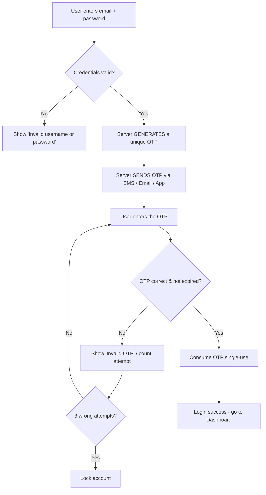
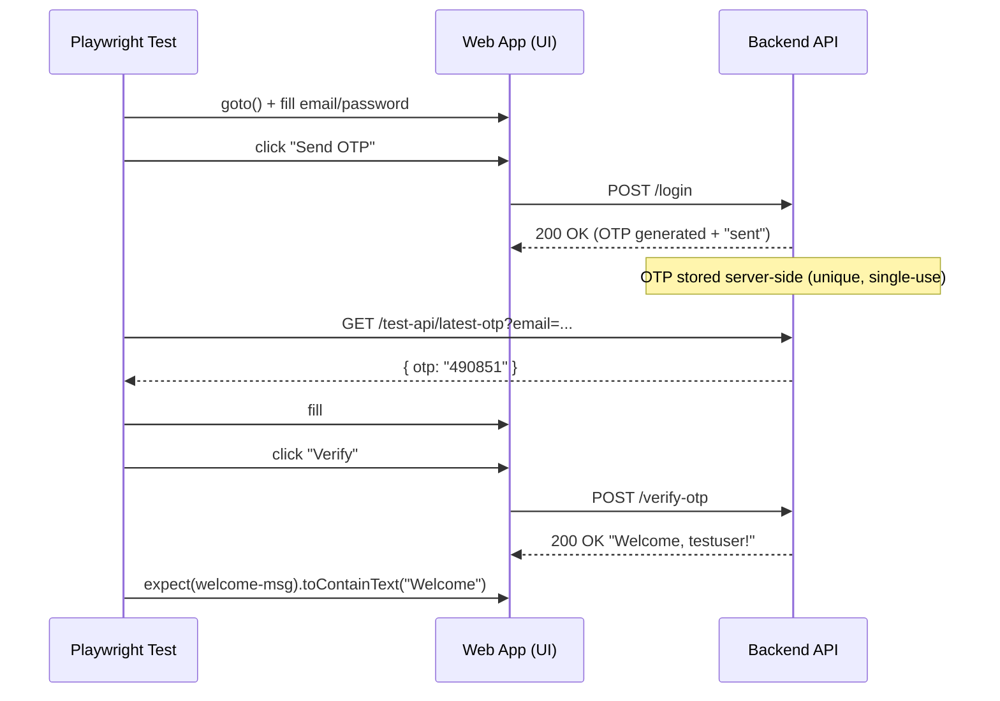

# OTP (One-Time Password) Validation — UI Automation with Playwright (JavaScript)

A complete, self-contained lesson for students. It includes:

1. What OTP is and why it is hard to automate
2. The 4 strategies to get an OTP inside a test
3. A **demo application** (`otp-demo.html`) you can run locally — no server, no internet
4. A **Playwright test file** (`OTP_Validation.spec.js`) covering positive, negative and UI scenarios
5. Step-by-step setup & run instructions
6. A quick revision checklist
7. **How to answer OTP questions in an interview**
8. A **real backend API** (`otp-api`: Node.js + Express) + API tests (`OTP_API.spec.js`)
9. Bonus: a **Colour Studio** website (HTML/CSS/JS)

---

## 1. What is OTP?

**OTP = One-Time Password.** A short numeric/alphanumeric code (usually 4–6 digits) sent to the user via **SMS, Email, or an Authenticator app (TOTP)**. The user enters it to prove ownership of the phone/email/device.

Common uses:
- Login (2FA / MFA)
- Signup / Email verification
- Password reset
- Payment confirmation (3DS)

---

## 2. The big challenge in automation

A real OTP is **dynamic** and unknown when you write the test — so you **cannot hardcode it**. There are 4 practical strategies:

| # | Strategy | When to use | How |
|---|----------|-------------|-----|
| 1 | **Static / Test OTP** | Most UI automation | Dev team sets a fixed OTP (e.g. `123456`) in the QA environment. Simplest & most stable. |
| 2 | **Database / API** | Backend exposes a test hook | Call a test-only endpoint to fetch the latest OTP. |
| 3 | **Email / SMS inbox** | Real end-to-end flow | Use Mailinator / MailSlurp / Mailosaur (email) or Twilio (SMS), then extract the code with regex. |
| 4 | **TOTP generation** | Authenticator-app 2FA | Generate the code in-test from the shared secret using `otplib`. |

---

## 2a. The OTP End-to-End Flow

**How a real OTP login works (user's point of view):**



**How the AUTOMATION test flow works (Strategy 2 — API):**



**The 3-step mental model every tester should remember:**

1. **Trigger** the OTP (log in → app asks the server to generate & send a code).
2. **Fetch** the OTP (from a test API, DB, email/SMS inbox, or generate a TOTP — never hardcode).
3. **Enter & Verify** (type it in the UI and assert the success/error result).

> Golden rule: the test's job is to verify the **flow**, not to guess the code.
> Keep step 2 (fetching the OTP) a separate, reliable, deterministic helper.

---

## 3. Demo Application — `otp-demo.html`

Create a file named **`otp-demo.html`** and paste this in. You can double-click it to try the login/OTP flow manually.

**Built-in rules:**
- Valid login: `testuser@example.com` / `Password@123`
- **OTP is UNIQUE every time** — a fresh random 6-digit code is generated on each "Send OTP" / "Resend" (never hardcoded)
- The generated OTP is exposed through a **test hook** (`window.__getOtp()`) so automation can read it — this simulates calling a test-only backend API that returns the latest OTP
- OTP is **single-use** — once verified successfully it cannot be reused
- Wrong OTP -> "Invalid OTP"
- 3 wrong attempts -> account locks + Verify disabled
- Resend OTP -> disabled for a 5s countdown (and generates a new code)
- Show/Hide OTP -> toggles password/text

```html
<!DOCTYPE html>
<html lang="en">
<head>
  <meta charset="UTF-8" />
  <meta name="viewport" content="width=device-width, initial-scale=1.0" />
  <title>OTP Demo App</title>
  <style>
    body { font-family: Arial, sans-serif; max-width: 420px; margin: 40px auto; }
    .card { border: 1px solid #ddd; border-radius: 10px; padding: 24px; box-shadow: 0 2px 8px rgba(0,0,0,.08); }
    h2 { margin-top: 0; }
    input { width: 100%; padding: 10px; margin: 6px 0 14px; box-sizing: border-box; }
    button { padding: 10px 16px; margin-right: 8px; cursor: pointer; }
    button:disabled { opacity: .5; cursor: not-allowed; }
    .error { color: #c0392b; font-weight: bold; min-height: 20px; }
    .info  { color: #27ae60; font-weight: bold; min-height: 20px; }
    .hidden { display: none; }
    .muted { color: #888; font-size: 13px; }
  </style>
</head>
<body>

  <!-- ===================== LOGIN SCREEN ===================== -->
  <div id="login-screen" class="card">
    <h2>Login</h2>
    <label>Email</label>
    <input id="username" type="text" placeholder="testuser@example.com" />
    <label>Password</label>
    <input id="password" type="password" placeholder="Password@123" />
    <p id="login-error" class="error"></p>
    <button id="send-otp">Send OTP</button>
    <p class="muted">Hint: testuser@example.com / Password@123</p>
  </div>

  <!-- ===================== OTP SCREEN ===================== -->
  <div id="otp-screen" class="card hidden">
    <h2>Enter OTP</h2>
    <p class="muted">A fresh 6-digit code was generated and "sent".</p>
    <label>OTP</label>
    <input id="otp" type="password" maxlength="6" placeholder="______" />
    <button id="toggle-otp-visibility" type="button">Show</button>
    <br /><br />
    <p id="otp-error" class="error"></p>
    <p id="otp-sent-msg" class="info"></p>
    <button id="verify-otp">Verify</button>
    <button id="resend-otp" disabled>Resend OTP</button>
    <span id="resend-timer" class="muted"></span>
  </div>

  <!-- ===================== DASHBOARD SCREEN ===================== -->
  <div id="dashboard-screen" class="card hidden">
    <h2 id="welcome-msg"></h2>
    <p>You are logged in.</p>
    <button id="logout">Logout</button>
  </div>

  <script>
    const VALID_USER = 'testuser@example.com';
    const VALID_PASS = 'Password@123';
    const MAX_ATTEMPTS = 3;
    const RESEND_SECONDS = 5;

    let wrongAttempts = 0;
    let locked = false;
    let currentOtp = null; // regenerated on each send/resend

    const $ = (id) => document.getElementById(id);
    const show = (id) => $(id).classList.remove('hidden');
    const hide = (id) => $(id).classList.add('hidden');

    // Generate a UNIQUE 6-digit OTP. In real life the SERVER does this and
    // sends it via SMS/Email. Here we expose it via a TEST HOOK (window.__getOtp)
    // so automation can read it - just like a test-only backend API.
    function generateOtp() {
      currentOtp = String(Math.floor(100000 + Math.random() * 900000));
      window.__getOtp = () => currentOtp;
      return currentOtp;
    }

    function startResendTimer() {
      let remaining = RESEND_SECONDS;
      $('resend-otp').disabled = true;
      $('resend-timer').textContent = `Resend available in ${remaining}s`;
      const interval = setInterval(() => {
        remaining--;
        if (remaining <= 0) {
          clearInterval(interval);
          $('resend-otp').disabled = false;
          $('resend-timer').textContent = '';
        } else {
          $('resend-timer').textContent = `Resend available in ${remaining}s`;
        }
      }, 1000);
    }

    $('send-otp').addEventListener('click', () => {
      $('login-error').textContent = '';
      const user = $('username').value.trim();
      const pass = $('password').value;
      if (user === VALID_USER && pass === VALID_PASS) {
        generateOtp(); // fresh, unique OTP for this login
        hide('login-screen');
        show('otp-screen');
        startResendTimer();
      } else {
        $('login-error').textContent = 'Invalid username or password';
      }
    });

    $('otp').addEventListener('input', (e) => {
      e.target.value = e.target.value.replace(/\D/g, '').slice(0, 6);
    });

    $('toggle-otp-visibility').addEventListener('click', () => {
      const otp = $('otp');
      if (otp.type === 'password') {
        otp.type = 'text';
        $('toggle-otp-visibility').textContent = 'Hide';
      } else {
        otp.type = 'password';
        $('toggle-otp-visibility').textContent = 'Show';
      }
    });

    $('verify-otp').addEventListener('click', () => {
      $('otp-error').textContent = '';
      $('otp-sent-msg').textContent = '';
      if (locked) return;
      const code = $('otp').value;
      if (code.length === 0) {
        $('otp-error').textContent = 'OTP is required';
        return;
      }
      if (code.length < 6) {
        $('otp-error').textContent = 'Please enter 6 digit OTP';
        return;
      }
      if (code === currentOtp) {
        currentOtp = null; // single-use: consume after success
        hide('otp-screen');
        show('dashboard-screen');
        $('welcome-msg').textContent = 'Welcome, testuser!';
        location.hash = 'dashboard';
      } else {
        wrongAttempts++;
        if (wrongAttempts >= MAX_ATTEMPTS) {
          locked = true;
          $('otp-error').textContent = 'Account locked - too many attempts';
          $('verify-otp').disabled = true;
        } else {
          $('otp-error').textContent = 'Invalid OTP';
        }
      }
    });

    $('resend-otp').addEventListener('click', () => {
      generateOtp(); // resend creates a NEW unique OTP
      $('otp-sent-msg').textContent = 'OTP sent successfully';
      startResendTimer();
    });

    $('logout').addEventListener('click', () => {
      hide('dashboard-screen');
      show('login-screen');
      $('username').value = '';
      $('password').value = '';
      $('otp').value = '';
      wrongAttempts = 0;
      locked = false;
      $('verify-otp').disabled = false;
      location.hash = '';
    });
  </script>
</body>
</html>
```

---

## 4. Playwright Test File — `OTP_Validation.spec.js`

Create a file named **`OTP_Validation.spec.js`** in the **same folder** as `otp-demo.html` and paste this in.

```javascript
import { test, expect } from '@playwright/test';

// Build a file:// URL to the demo app that sits next to this test file.
const APP_URL = new URL('./otp-demo.html', import.meta.url).href;

// Helper: fills OTP into a single field OR multiple digit-boxes.
async function enterOtp(page, otp) {
  const boxes = page.locator('[data-testid="otp-box"]');
  const count = await boxes.count();
  if (count > 1) {
    for (let i = 0; i < otp.length; i++) {
      await boxes.nth(i).fill(otp[i]);
    }
  } else {
    await page.locator('#otp').fill(otp);
  }
}

// Reusable step: log in and reach the OTP screen.
async function goToOtpScreen(page) {
  await page.goto(APP_URL);
  await page.fill('#username', 'testuser@example.com');
  await page.fill('#password', 'Password@123');
  await page.click('#send-otp');
  await expect(page.locator('#otp-screen')).toBeVisible();
}

// Read the freshly generated (UNIQUE) OTP from the app's test hook.
// This mimics Strategy 2 - calling a test-only backend API. Never hardcode!
async function getGeneratedOtp(page) {
  return await page.evaluate(() => window.__getOtp());
}

// ===================== POSITIVE SCENARIOS =====================
test.describe('OTP - Positive Scenarios', () => {

  // DYNAMIC OTP: unique each login, read via the test hook (not hardcoded)
  test('Valid OTP allows the user to log in successfully', async ({ page }) => {
    await goToOtpScreen(page);
    const otp = await getGeneratedOtp(page);
    await enterOtp(page, otp);
    await page.click('#verify-otp');
    await expect(page).toHaveURL(/.*dashboard/);
    await expect(page.locator('#welcome-msg')).toContainText('Welcome');
  });

  // STRATEGY 2: OTP from a test API (needs a real backend) - learning only
  test.skip('Valid OTP fetched from test API is accepted', async ({ page, request }) => {
    const email = 'apitest@example.com';
    await page.goto('https://your-app.com/login');
    await page.fill('#username', email);
    await page.click('#send-otp');
    const res = await request.get(`https://your-app.com/test-api/latest-otp?email=${email}`);
    const { otp } = await res.json();
    await enterOtp(page, otp);
    await page.click('#verify-otp');
    await expect(page).toHaveURL(/.*dashboard/);
  });

  // STRATEGY 4: TOTP (Authenticator app) - needs `npm install otplib`
  test.skip('Valid TOTP generated from shared secret is accepted', async ({ page }) => {
    const { authenticator } = await import('otplib');
    const SECRET = 'JBSWY3DPEHPK3PXP';
    const totp = authenticator.generate(SECRET);
    await page.goto('https://your-app.com/login');
    await page.fill('#username', 'mfauser@example.com');
    await page.fill('#password', 'Password@123');
    await page.click('#send-otp');
    await enterOtp(page, totp);
    await page.click('#verify-otp');
    await expect(page).toHaveURL(/.*dashboard/);
  });
});

// ===================== NEGATIVE SCENARIOS =====================
test.describe('OTP - Negative Scenarios', () => {

  test.beforeEach(async ({ page }) => {
    await goToOtpScreen(page);
  });

  test('Invalid / wrong OTP shows an error and blocks login', async ({ page }) => {
    await enterOtp(page, '000000');
    await page.click('#verify-otp');
    await expect(page.locator('#otp-error')).toBeVisible();
    await expect(page.locator('#otp-error')).toContainText('Invalid OTP');
    await expect(page).not.toHaveURL(/.*dashboard/);
  });

  test('Empty OTP submission is not allowed', async ({ page }) => {
    await page.click('#verify-otp');
    await expect(page.locator('#otp-error')).toContainText(/required|enter/i);
  });

  test('OTP with fewer digits than required is rejected', async ({ page }) => {
    await page.locator('#otp').fill('123');
    await page.click('#verify-otp');
    await expect(page.locator('#otp-error')).toContainText(/6 digit/i);
  });

  test('OTP field rejects non-numeric characters', async ({ page }) => {
    await page.locator('#otp').fill('abcdef');
    const value = await page.locator('#otp').inputValue();
    expect(value).toMatch(/^\d*$/);
  });

  test('Account locks after multiple wrong OTP attempts (brute-force guard)', async ({ page }) => {
    for (let attempt = 1; attempt <= 3; attempt++) {
      await enterOtp(page, '000000');
      await page.click('#verify-otp');
    }
    await expect(page.locator('#otp-error')).toContainText(/locked|too many attempts/i);
    await expect(page.locator('#verify-otp')).toBeDisabled();
  });

  // Need a real backend - learning only
  test.skip('Expired OTP is rejected', async ({ page }) => {
    await page.waitForTimeout(1000);
    await enterOtp(page, '123456');
    await page.click('#verify-otp');
    await expect(page.locator('#otp-error')).toContainText(/expired/i);
  });

  test('Reused (already consumed) OTP cannot be used twice', async ({ page }) => {
    const otp = await getGeneratedOtp(page);
    await enterOtp(page, otp);
    await page.click('#verify-otp');
    await expect(page).toHaveURL(/.*dashboard/);
    await page.click('#logout');
    await page.fill('#username', 'testuser@example.com');
    await page.fill('#password', 'Password@123');
    await page.click('#send-otp');
    await enterOtp(page, otp); // old, already-consumed code
    await page.click('#verify-otp');
    await expect(page.locator('#otp-error')).toContainText(/invalid/i);
  });
});

// ===================== UI / UX SCENARIOS =====================
test.describe('OTP - UI & UX Scenarios', () => {

  test.beforeEach(async ({ page }) => {
    await goToOtpScreen(page);
  });

  test('Resend OTP button is disabled until the timer finishes', async ({ page }) => {
    await expect(page.locator('#resend-otp')).toBeDisabled();
    await expect(page.locator('#resend-timer')).toBeVisible();
  });

  test('Resend OTP becomes clickable after the countdown', async ({ page }) => {
    await expect(page.locator('#resend-otp')).toBeEnabled({ timeout: 10000 });
    await page.click('#resend-otp');
    await expect(page.locator('#otp-sent-msg')).toContainText(/sent/i);
  });

  test('OTP input allows only the maximum number of digits', async ({ page }) => {
    await page.locator('#otp').fill('1234567890');
    const value = await page.locator('#otp').inputValue();
    expect(value.length).toBeLessThanOrEqual(6);
  });

  test('Masking / visibility toggle works', async ({ page }) => {
    const otpInput = page.locator('#otp');
    await expect(otpInput).toHaveAttribute('type', 'password');
    await page.click('#toggle-otp-visibility');
    await expect(otpInput).toHaveAttribute('type', 'text');
  });

  // Multi-box UIs only - learning only
  test.skip('Auto-focus moves to the next box as each digit is typed', async ({ page }) => {
    const boxes = page.locator('[data-testid="otp-box"]');
    await boxes.nth(0).fill('1');
    await expect(boxes.nth(1)).toBeFocused();
  });
});

// ===================== EMAIL-BASED OTP (STRATEGY 3) =====================
// Needs `npm install mailosaur` and a real app - learning only
test.describe('OTP - Email based (real inbox)', () => {

  test.skip('OTP received by email is read and used to log in', async ({ page }) => {
    const { default: MailosaurClient } = await import('mailosaur');
    const mailosaur = new MailosaurClient('YOUR_API_KEY');
    const serverId = 'YOUR_SERVER_ID';
    const testEmail = `otp-test@${serverId}.mailosaur.net`;
    await page.goto('https://your-app.com/login');
    await page.fill('#username', testEmail);
    await page.click('#send-otp');
    const email = await mailosaur.messages.get(serverId, { sentTo: testEmail });
    const match = email.text.body.match(/\b(\d{6})\b/);
    expect(match, 'Could not find a 6-digit OTP in the email').not.toBeNull();
    const otp = match[1];
    await enterOtp(page, otp);
    await page.click('#verify-otp');
    await expect(page).toHaveURL(/.*dashboard/);
  });
});
```

---

## 5. Setup & Run instructions

Put both files (`otp-demo.html` and `OTP_Validation.spec.js`) in the **same folder**, then run:

```powershell
npm init -y
npm install -D @playwright/test
npx playwright install
npx playwright test OTP_Validation.spec.js
```

To watch it in a real browser window:

```powershell
npx playwright test OTP_Validation.spec.js --headed
```

To open the HTML report after a run:

```powershell
npx playwright show-report
```

> The tests marked `test.skip(...)` (API, TOTP, Email) point to a fake `https://your-app.com`. They are **learning examples only** and will not run against the demo — they need a real backend/service.

---

## 6. Quick revision checklist (for exams / interviews)

- **POSITIVE:** valid OTP logs in, resend works, correct code from email / SMS / TOTP
- **NEGATIVE:** wrong OTP, empty OTP, short OTP, letters, expired OTP, reused OTP, account lock after N wrong attempts
- **UI/UX:** resend timer, auto-focus between boxes, max length, masking/visibility, paste behaviour, clear error messages
- **SECURITY:** OTP not exposed in URL/response, rate limiting, single-use only

---

# How to Answer OTP Questions in an Interview

## The 30-second headline answer
> "The key challenge with OTP is that it's **dynamic** — you can't hardcode it.
> So the first thing I clarify is *how the OTP is delivered* (SMS, Email, or an
> Authenticator app), then I pick the right strategy to fetch it at runtime.
> In most projects I ask the dev team for a **static test OTP** in the QA
> environment, or read the code from a **test API / database**. For real
> end-to-end I use an **email/SMS service** like Mailosaur, and for authenticator
> apps I **generate the TOTP** in code."

## Q: "How do you handle OTP in automation?"
Explain the **4 strategies** (shows breadth):

| Strategy | One-line answer |
|----------|-----------------|
| **Static test OTP** | "Dev team fixes an OTP like `000000` in QA — simplest and most stable." |
| **API / DB read** | "Call a test-only endpoint that returns the last OTP for that user." |
| **Email / SMS inbox** | "Use Mailosaur/MailSlurp/Twilio, then extract the code with a regex." |
| **TOTP generation** | "For Google Authenticator style, generate the code from the shared secret using `otplib`." |

Golden line: **"I never hardcode a real OTP, because it's single-use and expires."**

## Q: "What scenarios would you test?"
Group the answer — it signals structured thinking:
- **Positive:** valid OTP logs in; resend works.
- **Negative:** wrong OTP, empty, fewer than 6 digits, non-numeric, **expired** OTP, **reused** OTP, **account lock** after N wrong attempts.
- **UI/UX:** resend timer/countdown, auto-focus between boxes, max length, masking/show-hide.
- **Security:** OTP not exposed in URL/response, rate limiting, single-use only.

## Q: "How do you get the OTP value in your test?"
Give a concrete example:
> "In my project the backend exposed a test-only endpoint. I called it with
> Playwright's API request, read the code, and typed it in:"

```javascript
const res = await request.get(`${BASE_URL}/test-api/latest-otp?email=${email}`);
const { otp } = await res.json();
await page.fill('#otp', otp);
```

> "If it were email-based, I'd fetch the message from Mailosaur and extract it
> with `body.match(/\b(\d{6})\b/)`."

## Follow-up traps & sharp answers
- **"What if the OTP expires during the test?"** → "I fetch it right before entering it, keep the test fast, and if needed use a test hook to extend/reset expiry."
- **"How do you test the expiry itself?"** → "Ask backend for a short TTL in QA, or a test hook to force expiry, then assert the 'OTP expired' error."
- **"Isn't a test-only API a security risk?"** → "Yes — it must be **disabled in production**, enabled only in QA behind auth."
- **"Static OTP vs real OTP — which is better?"** → "Static is stable and fast for UI regression; real (email/API) is better for true end-to-end confidence. I use static for most UI suites and one real e2e for coverage."

## Closing line that impresses
> "My rule: **isolate the OTP source from the UI test.** The test's job is to
> verify the *flow*, not to guess the code — so I make fetching the OTP a
> reliable, deterministic step."

---

# 7. Real Backend API (Strategy 2 done properly)

Instead of a browser-only hook, here is a **real Node.js + Express backend** that
generates OTPs and exposes a test-only endpoint to fetch them. This is exactly how
teams enable OTP automation in QA environments.

## Folder structure
```
otp-api/
  package.json
  server.js
  public/
    index.html   (UI that calls the API via fetch)
```

## API endpoints
| Method | Endpoint | What it does |
|--------|----------|--------------|
| `POST` | `/login` | Validates user, generates a **unique** OTP, "sends" it |
| `POST` | `/verify-otp` | Verifies the entered OTP (single-use, expiry, lockout) |
| `GET`  | `/test-api/latest-otp?email=...` | **Test-only** — returns the latest OTP for automation |

## `package.json`
```json
{
  "name": "otp-api",
  "version": "1.0.0",
  "type": "module",
  "main": "server.js",
  "scripts": { "start": "node server.js" },
  "dependencies": { "express": "^4.19.2" }
}
```

## `server.js`
```javascript
import express from 'express';
import path from 'path';
import { fileURLToPath } from 'url';

const __dirname = path.dirname(fileURLToPath(import.meta.url));

const app = express();
app.use(express.json());
app.use(express.static(path.join(__dirname, 'public')));

const PORT = process.env.PORT || 3000;

const VALID_USER = 'testuser@example.com';
const VALID_PASS = 'Password@123';
const MAX_ATTEMPTS = 3;
const OTP_TTL_MS = 2 * 60 * 1000; // OTP valid for 2 minutes

// email -> { otp, expiresAt, attempts, locked }
const otpStore = new Map();

function generateOtp() {
  return String(Math.floor(100000 + Math.random() * 900000)); // unique 6-digit
}

app.post('/login', (req, res) => {
  const { email, password } = req.body || {};
  if (email !== VALID_USER || password !== VALID_PASS) {
    return res.status(401).json({ ok: false, message: 'Invalid username or password' });
  }
  const otp = generateOtp();
  otpStore.set(email, { otp, expiresAt: Date.now() + OTP_TTL_MS, attempts: 0, locked: false });
  console.log(`[OTP sent] ${email} -> ${otp}`); // real system: send via SMS/Email
  return res.json({ ok: true, message: 'OTP sent' });
});

app.post('/verify-otp', (req, res) => {
  const { email, otp } = req.body || {};
  const record = otpStore.get(email);
  if (!record) return res.status(400).json({ ok: false, message: 'No OTP requested' });
  if (record.locked) return res.status(423).json({ ok: false, message: 'Account locked - too many attempts' });
  if (Date.now() > record.expiresAt) return res.status(410).json({ ok: false, message: 'OTP expired' });
  if (!otp || String(otp).length < 6) return res.status(400).json({ ok: false, message: 'Please enter 6 digit OTP' });

  if (String(otp) === record.otp) {
    otpStore.delete(email); // single-use
    return res.json({ ok: true, message: 'Welcome, testuser!' });
  }
  record.attempts++;
  if (record.attempts >= MAX_ATTEMPTS) {
    record.locked = true;
    return res.status(423).json({ ok: false, message: 'Account locked - too many attempts' });
  }
  return res.status(401).json({ ok: false, message: 'Invalid OTP' });
});

// TEST-ONLY: automation reads the freshly generated OTP here.
// In production this endpoint MUST NOT exist.
app.get('/test-api/latest-otp', (req, res) => {
  const record = otpStore.get(req.query.email);
  if (!record) return res.status(404).json({ ok: false, message: 'No OTP found for this email' });
  return res.json({ ok: true, otp: record.otp });
});

app.listen(PORT, () => console.log(`OTP demo API running at http://localhost:${PORT}`));
```

## `public/index.html` (UI that calls the API)
```html
<!DOCTYPE html>
<html lang="en">
<head>
  <meta charset="UTF-8" />
  <meta name="viewport" content="width=device-width, initial-scale=1.0" />
  <title>OTP Demo (API-backed)</title>
  <style>
    body { font-family: Arial, sans-serif; max-width: 420px; margin: 40px auto; }
    .card { border: 1px solid #ddd; border-radius: 10px; padding: 24px; }
    input { width: 100%; padding: 10px; margin: 6px 0 14px; box-sizing: border-box; }
    button { padding: 10px 16px; margin-right: 8px; cursor: pointer; }
    button:disabled { opacity: .5; cursor: not-allowed; }
    .error { color: #c0392b; font-weight: bold; min-height: 20px; }
    .info  { color: #27ae60; font-weight: bold; min-height: 20px; }
    .hidden { display: none; }
    .muted { color: #888; font-size: 13px; }
  </style>
</head>
<body>
  <div id="login-screen" class="card">
    <h2>Login</h2>
    <label>Email</label>
    <input id="username" type="text" placeholder="testuser@example.com" />
    <label>Password</label>
    <input id="password" type="password" placeholder="Password@123" />
    <p id="login-error" class="error"></p>
    <button id="send-otp">Send OTP</button>
    <p class="muted">Hint: testuser@example.com / Password@123</p>
  </div>

  <div id="otp-screen" class="card hidden">
    <h2>Enter OTP</h2>
    <p class="muted">A fresh 6-digit code was generated by the server.</p>
    <label>OTP</label>
    <input id="otp" type="password" maxlength="6" placeholder="______" />
    <button id="toggle-otp-visibility" type="button">Show</button>
    <br /><br />
    <p id="otp-error" class="error"></p>
    <button id="verify-otp">Verify</button>
  </div>

  <div id="dashboard-screen" class="card hidden">
    <h2 id="welcome-msg"></h2>
    <p>You are logged in.</p>
    <button id="logout">Logout</button>
  </div>

  <script>
    const $ = (id) => document.getElementById(id);
    const show = (id) => $(id).classList.remove('hidden');
    const hide = (id) => $(id).classList.add('hidden');
    let currentEmail = '';

    $('send-otp').addEventListener('click', async () => {
      $('login-error').textContent = '';
      currentEmail = $('username').value.trim();
      const res = await fetch('/login', {
        method: 'POST',
        headers: { 'Content-Type': 'application/json' },
        body: JSON.stringify({ email: currentEmail, password: $('password').value }),
      });
      const data = await res.json();
      if (data.ok) { hide('login-screen'); show('otp-screen'); }
      else { $('login-error').textContent = data.message; }
    });

    $('otp').addEventListener('input', (e) => {
      e.target.value = e.target.value.replace(/\D/g, '').slice(0, 6);
    });

    $('toggle-otp-visibility').addEventListener('click', () => {
      const otp = $('otp');
      otp.type = otp.type === 'password' ? 'text' : 'password';
      $('toggle-otp-visibility').textContent = otp.type === 'password' ? 'Show' : 'Hide';
    });

    $('verify-otp').addEventListener('click', async () => {
      $('otp-error').textContent = '';
      const res = await fetch('/verify-otp', {
        method: 'POST',
        headers: { 'Content-Type': 'application/json' },
        body: JSON.stringify({ email: currentEmail, otp: $('otp').value }),
      });
      const data = await res.json();
      if (data.ok) {
        hide('otp-screen'); show('dashboard-screen');
        $('welcome-msg').textContent = data.message;
        location.hash = 'dashboard';
      } else {
        $('otp-error').textContent = data.message;
        if (data.message.toLowerCase().includes('locked')) $('verify-otp').disabled = true;
      }
    });

    $('logout').addEventListener('click', () => {
      hide('dashboard-screen'); show('login-screen');
      $('username').value = ''; $('password').value = ''; $('otp').value = '';
      $('verify-otp').disabled = false; location.hash = '';
    });
  </script>
</body>
</html>
```

## How to run the API
```powershell
cd otp-api
npm install
npm start
```
Then open **http://localhost:3000**.

## Playwright test against the live API — `OTP_API.spec.js`
Start the API first (`npm start` in `otp-api`), then run: `npx playwright test OTP_API.spec.js`

```javascript
import { test, expect } from '@playwright/test';

const BASE_URL = 'http://localhost:3000';
const EMAIL = 'testuser@example.com';
const PASSWORD = 'Password@123';

async function login(page) {
  await page.goto(BASE_URL);
  await page.fill('#username', EMAIL);
  await page.fill('#password', PASSWORD);
  await page.click('#send-otp');
  await expect(page.locator('#otp-screen')).toBeVisible();
}

async function fetchOtpFromApi(request) {
  const res = await request.get(`${BASE_URL}/test-api/latest-otp?email=${EMAIL}`);
  expect(res.ok()).toBeTruthy();
  const { otp } = await res.json();
  return otp;
}

test.describe('OTP via real API', () => {

  test('Valid OTP (fetched from API) logs in successfully', async ({ page, request }) => {
    await login(page);
    const otp = await fetchOtpFromApi(request); // unique code, not hardcoded
    await page.fill('#otp', otp);
    await page.click('#verify-otp');
    await expect(page.locator('#welcome-msg')).toContainText('Welcome');
  });

  test('Wrong OTP shows an error', async ({ page }) => {
    await login(page);
    await page.fill('#otp', '000000');
    await page.click('#verify-otp');
    await expect(page.locator('#otp-error')).toContainText('Invalid OTP');
  });

  test('Account locks after 3 wrong attempts', async ({ page }) => {
    await login(page);
    for (let i = 0; i < 3; i++) {
      await page.fill('#otp', '000000');
      await page.click('#verify-otp');
    }
    await expect(page.locator('#otp-error')).toContainText(/locked/i);
    await expect(page.locator('#verify-otp')).toBeDisabled();
  });

  test('OTP is single-use - cannot be reused after success', async ({ page, request }) => {
    await login(page);
    const otp = await fetchOtpFromApi(request);
    await page.fill('#otp', otp);
    await page.click('#verify-otp');
    await expect(page.locator('#welcome-msg')).toContainText('Welcome');

    await page.click('#logout');
    await page.fill('#username', EMAIL);
    await page.fill('#password', PASSWORD);
    await page.click('#send-otp');
    await page.fill('#otp', otp); // old, consumed code
    await page.click('#verify-otp');
    await expect(page.locator('#otp-error')).toContainText('Invalid OTP');
  });

  test('API-only: login returns ok and OTP endpoint returns a 6-digit code', async ({ request }) => {
    const loginRes = await request.post(`${BASE_URL}/login`, {
      data: { email: EMAIL, password: PASSWORD },
    });
    expect(loginRes.ok()).toBeTruthy();
    expect((await loginRes.json()).ok).toBe(true);

    const otpRes = await request.get(`${BASE_URL}/test-api/latest-otp?email=${EMAIL}`);
    const { otp } = await otpRes.json();
    expect(otp).toMatch(/^\d{6}$/);
  });
});
```

> **Verified working:** login returns `OTP sent`, the API returns a unique code
> (e.g. `490851`), and verify returns `Welcome, testuser!`.

## Postman collection (`OTP_Demo_API.postman_collection.json`)

A ready-to-import Postman collection is included so you can demo the API manually.

**Requests (each has test assertions):**

| # | Request | Method | Purpose |
|---|---------|--------|---------|
| 1 | Login (generate + send OTP) | `POST /login` | Generates a unique OTP |
| 2 | Get Latest OTP (Test-only) | `GET /test-api/latest-otp` | Reads OTP and **auto-saves it to `{{otp}}`** |
| 3 | Verify OTP (Valid) | `POST /verify-otp` | Uses `{{otp}}` and logs in |
| 4 | Verify OTP (Wrong) | `POST /verify-otp` | Negative — expects "Invalid OTP" |
| 5 | Login (Invalid credentials) | `POST /login` | Negative — expects 401 |

**Collection variables:** `{{baseUrl}}` (default `http://localhost:3000`), `{{email}}`, `{{password}}`, `{{otp}}`.

**Key trick:** request #2 has a test script that saves the OTP so request #3 uses it automatically — no copy-paste:
```javascript
const body = pm.response.json();
pm.collectionVariables.set('otp', body.otp);
```

**How to use in Postman:**
1. Start the API: `cd otp-api` then `npm start`
2. In Postman: **Import** -> select `OTP_Demo_API.postman_collection.json`
3. Run requests in order **1 -> 2 -> 3** (or use the **Collection Runner** to run all)

Save the collection JSON as **`OTP_Demo_API.postman_collection.json`**:

```json
{
  "info": {
    "name": "OTP Demo API",
    "schema": "https://schema.getpostman.com/json/collection/v2.1.0/collection.json"
  },
  "variable": [
    { "key": "baseUrl", "value": "http://localhost:3000", "type": "string" },
    { "key": "email", "value": "testuser@example.com", "type": "string" },
    { "key": "password", "value": "Password@123", "type": "string" },
    { "key": "otp", "value": "", "type": "string" }
  ],
  "item": [
    {
      "name": "1. Login (generate + send OTP)",
      "request": {
        "method": "POST",
        "header": [ { "key": "Content-Type", "value": "application/json" } ],
        "body": { "mode": "raw", "raw": "{\n  \"email\": \"{{email}}\",\n  \"password\": \"{{password}}\"\n}" },
        "url": { "raw": "{{baseUrl}}/login", "host": ["{{baseUrl}}"], "path": ["login"] }
      },
      "event": [ { "listen": "test", "script": { "type": "text/javascript", "exec": [
        "pm.test('Status is 200', () => pm.response.to.have.status(200));",
        "const body = pm.response.json();",
        "pm.test('ok is true', () => pm.expect(body.ok).to.be.true);"
      ] } } ]
    },
    {
      "name": "2. Get Latest OTP (Test-only)",
      "request": {
        "method": "GET",
        "header": [],
        "url": {
          "raw": "{{baseUrl}}/test-api/latest-otp?email={{email}}",
          "host": ["{{baseUrl}}"], "path": ["test-api", "latest-otp"],
          "query": [ { "key": "email", "value": "{{email}}" } ]
        }
      },
      "event": [ { "listen": "test", "script": { "type": "text/javascript", "exec": [
        "const body = pm.response.json();",
        "pm.test('OTP is 6 digits', () => pm.expect(body.otp).to.match(/^\\d{6}$/));",
        "pm.collectionVariables.set('otp', body.otp);"
      ] } } ]
    },
    {
      "name": "3. Verify OTP (Valid)",
      "request": {
        "method": "POST",
        "header": [ { "key": "Content-Type", "value": "application/json" } ],
        "body": { "mode": "raw", "raw": "{\n  \"email\": \"{{email}}\",\n  \"otp\": \"{{otp}}\"\n}" },
        "url": { "raw": "{{baseUrl}}/verify-otp", "host": ["{{baseUrl}}"], "path": ["verify-otp"] }
      },
      "event": [ { "listen": "test", "script": { "type": "text/javascript", "exec": [
        "pm.test('Status is 200', () => pm.response.to.have.status(200));",
        "const body = pm.response.json();",
        "pm.test('Welcome message', () => pm.expect(body.message).to.include('Welcome'));"
      ] } } ]
    },
    {
      "name": "4. Verify OTP (Wrong) - negative",
      "request": {
        "method": "POST",
        "header": [ { "key": "Content-Type", "value": "application/json" } ],
        "body": { "mode": "raw", "raw": "{\n  \"email\": \"{{email}}\",\n  \"otp\": \"000000\"\n}" },
        "url": { "raw": "{{baseUrl}}/verify-otp", "host": ["{{baseUrl}}"], "path": ["verify-otp"] }
      },
      "event": [ { "listen": "test", "script": { "type": "text/javascript", "exec": [
        "pm.test('Status is 401', () => pm.response.to.have.status(401));",
        "const body = pm.response.json();",
        "pm.test('Invalid OTP message', () => pm.expect(body.message).to.eql('Invalid OTP'));"
      ] } } ]
    },
    {
      "name": "5. Login (Invalid credentials) - negative",
      "request": {
        "method": "POST",
        "header": [ { "key": "Content-Type", "value": "application/json" } ],
        "body": { "mode": "raw", "raw": "{\n  \"email\": \"wrong@example.com\",\n  \"password\": \"badpass\"\n}" },
        "url": { "raw": "{{baseUrl}}/login", "host": ["{{baseUrl}}"], "path": ["login"] }
      },
      "event": [ { "listen": "test", "script": { "type": "text/javascript", "exec": [
        "pm.test('Status is 401', () => pm.response.to.have.status(401));",
        "const body = pm.response.json();",
        "pm.test('Invalid credentials message', () => pm.expect(body.message).to.eql('Invalid username or password'));"
      ] } } ]
    }
  ]
}
```

